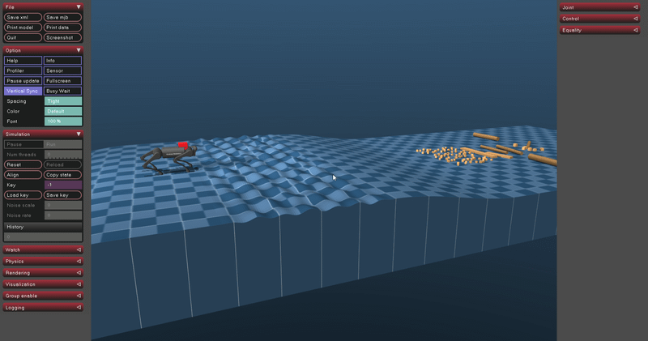

# TerrAdapt

### When Does Adaptive Control Need a Universal Function Approximator?
*A structure-versus-capacity study on a quadruped robot — KOM 521E Term Project, Istanbul Technical University*

<p align="center">
  
</p>

📄 **Report:** [`stage_b/report/terradapt_report.pdf`](stage_b/report/terradapt_report.pdf)

---

## Overview

Classical adaptive control needs the designer to know the **structure** of the
uncertainty. Neural-network adaptive control drops that requirement but needs
many more parameters. This project measures **when that cost pays off**.

Two papers are the starting point:

- **Sombolestan & Nguyen**, *IEEE T-RO* 40 (2024): adaptive-force-based MPC
  with an L1-type adaptive law for legged locomotion over uneven terrain.
- **Patil, Le, Greene & Dixon**, *IEEE L-CSS* 6 (2022): a Lyapunov-based deep
  neural network (Lb-DNN) whose inner and outer weights are updated by
  Lyapunov-derived laws, with no backpropagation.

I implemented a convex single-rigid-body MPC with an L1-type state predictor on
a simulated **Unitree A1** in **MuJoCo**. Inside that one architecture I
compared **five adaptive layers with 6 to 390 parameters**. All of them use
matched adaptation gains and three random seeds, and every hypothesis test had
its decision rule written before the experiment ran. Every layer keeps the
Lyapunov stability argument of the L1 structure. Eight verification tests
passed, including V̇ ≤ 0 for every layer.

### Key findings

- **Adaptation is necessary.** Without it the robot stalls at 9.01 m and never
  finishes the combined course.
- At a well-chosen gain, **no scenario separated the methods** by success or
  failure.
- **Better estimation ≠ better control.** The best estimator was not the best
  controller.
- Almost all of the measurable benefit came from two classical ingredients:
  **integral action** (6 parameters) and **gait-phase knowledge** (12 parameters).
- A phase-aware classical regressor (M0F, 24 parameters) **beat the
  208-parameter Lb-DNN** on a swinging payload.
- The classical regressor's real advantage is **tolerance to gain mis-tuning**:
  it has the widest gain window.

> **Answer:** a universal function approximator becomes necessary when the
> structure of the disturbance *cannot be written down*. For the disturbances
> studied here (unknown payload, gait-induced leg dynamics, phase-locked
> pendulum) it could.

---

## Adaptive layers compared

| Layer | Form of θ̂ | Params | µs / step | % of 2 ms |
|---|---|---:|---:|---:|
| `none` | no adaptation (baseline MPC) | 0 | – | – |
| `M0I` | β̂ (pure integral action) | 6 | 191 | 9.5 |
| `M0` | α̂‖e‖ + β̂ (Sombolestan & Nguyen) | 12 | 213 | 10.7 |
| `M0F` | M0 + ĉ sin φ + d̂ cos φ (phase-aware) | 24 | 235 | 11.7 |
| `M1` | RBF, 64 Gaussians + bias | 390 | 278 | 13.9 |
| `M2` | Lb-DNN, 2×8 tanh (Patil et al.) | 208 | 522 | 26.1 |

### The ladder: what each step actually solves

| Step | Combined course (9 runs) | Terrain \|θₚ\| | What it solves |
|---|:---:|:---:|---|
| baseline | stalls at 9.01 m | 0.1219 | nothing (the MPC has no integral action) |
| M0I (6) | 6/9 | 0.0200 | **constant disturbance**: pitch 6× better, course completed |
| M0 (12) | **9/9** | 0.0200 | **widens the gain window** upward |
| M0F (24) | 4/9 | **0.0190** | **phase-locked disturbance**: best pitch, narrow window |
| M1 (390) | 5/9 | 0.0231 | best estimator on obstacles; nothing beyond M0 on the pendulum |
| M2 (208) | 6/9 | 0.0253 | what M0F solves, but with 208 parameters; seed-sensitive |

---

## Repository structure

```
.
├── stage_a/                 # Stage A: approximators on a 2-D benchmark plant
│   ├── plant.py             #   test plant from Patil et al. (2022), RK4 integrator
│   ├── approximators.py     #   M0 (linear), M1 (RBF), M2 (Lb-DNN)
│   ├── run_stage_a.py       #   closed-loop comparison
│   ├── ablation.py, generalization.py, verify_jacobian.py, make_figure.py
│   └── extract_a1*.py       #   reads Unitree A1 parameters from MuJoCo Menagerie
│
├── stage_b/                 # Stage B: adaptive MPC on the Unitree A1
│   ├── a1_params.py, a1_kinematics.py, srb_dynamics.py
│   ├── mpc.py               #   convex SRB-MPC (OSQP)
│   ├── gait.py, controller.py   # trot gait, stance/swing control
│   ├── adaptive.py          #   L1-type state predictor + adaptation laws
│   ├── approximators_b.py   #   none / M0I / M0 / M0F / M1 / M2
│   ├── make_*_model.py      #   build the MuJoCo scenes (torque, course, terrain, obstacles, pendulum)
│   ├── build_courses.py, course_def.py
│   ├── scenario.py          #   run one scenario / compare methods
│   ├── run_walk.py          #   simple walking run
│   ├── sweep_*.py           #   experiment sweeps with pre-registered decision rules
│   ├── verify_*.py          #   verification tests
│   └── report/              #   LaTeX report, figure scripts and figures
│
├── media/                   # README demo GIF
└── requirements.txt
```

---

## Installation

Requires **Python 3.10+** (developed on 3.11).

```bash
git clone <this-repo-url>
cd <repo>
pip install -r requirements.txt

# Robot model (not included in this repo, ~2.5 GB)
git clone https://github.com/google-deepmind/mujoco_menagerie.git
```

`mujoco_menagerie` has to be cloned **into the repository root**. The scripts
find `unitree_a1/` automatically by searching upward from their own folder.

---

## Usage

### Stage A: benchmark plant

```bash
cd stage_a
python run_stage_a.py
python make_figure.py
```

### Stage B: build the scenes (once)

Each script writes into `mujoco_menagerie/unitree_a1/` and needs the output of
the one before it:

```bash
cd stage_b
python make_torque_model.py            # position servos -> torque actuators
python make_course_model.py            # course robot model
python make_terrain_model.py           # ramp + plateau + rough + descent
python make_obstacle_model.py --fixed  # combined course: terrain + 84 fixed obstacles (T = 60 s)
python make_pendulum_model.py          # swinging-payload scene
```

### Stage B: run experiments

```bash
# Compare all methods on the terrain course at a matched gain
python scenario.py --terrain --compare --gamma 300 --payload-pos 0.12 0.05 0.06

# Single method with the live viewer
python scenario.py --obstacles --adaptive M0 --gamma 300 --view

# Main measurement: combined course, 3 gains x 3 seeds
python sweep_robust.py --baseline

# Swinging-payload experiment
python sweep_pendulum.py
```

Main `scenario.py` options: `--adaptive {none,M0I,M0,M0F,M1,M2}`, `--gamma`,
`--vx`, `--T`, `--seed`, `--terrain`, `--obstacles`, `--pendulum L`,
`--view`, `--live`, `--filter` (turns on the paper's C(s) low-pass filter,
which is off by default).

> Use `--gamma 300` when comparing methods. The default gains differ per
> method and are **not** matched.

### Report figures

```bash
cd stage_b/report
python make_figures.py
python fig_architecture.py
```

---

## Experimental setup (summary)

- **Robot:** torque-controlled Unitree A1 (MuJoCo Menagerie), trot with a 0.40 s period
- **Controller:** convex SRB-MPC, 13-D state, horizon 10 × 30 ms, re-solved every
  20 ms. The low level and the adaptive layer run every 2 ms.
- **Combined course:** flat start → 20 cm ramp (10°) → plateau → rough section
  (±3.5 cm) → descent → 84 fixed obstacles. Finish line at 10.68 m, 60 s limit.
- **Disturbance:** a 3 kg off-centre payload appears at t = 6 s without the
  controller being told about it.
- **Matching:** same adaptation gain γ ∈ {100, 300, 1000} for every method,
  3 seeds per cell. Fully deterministic simulation.

---

## Notes on the re-implementation

- Eq. (2) of Sombolestan & Nguyen (2024) has a **sign error**: it writes
  Θ̇ = R_z ω, but the correct form is Θ̇ = R_zᵀ ω. The code uses the corrected form.
- The paper's low-pass filter C(s) is **off by default**. It measured worse at
  every gain; `--filter` turns it back on.
- The regressor uses the tracking error ‖e‖ (T-RO Eqs. 27/30), not the
  prediction error ‖ẽ‖. Using ‖ẽ‖ creates a quadratic positive-feedback loop.

---

## References

1. M. Sombolestan and Q. Nguyen, "Adaptive-Force-Based Control of Dynamic Legged
   Locomotion Over Uneven Terrain," *IEEE Transactions on Robotics*, vol. 40,
   pp. 2462–2477, 2024.
2. O. S. Patil, D. M. Le, M. L. Greene, and W. E. Dixon, "Lyapunov-Derived
   Control and Adaptive Update Laws for Inner and Outer Layer Weights of a Deep
   Neural Network," *IEEE Control Systems Letters*, vol. 6, pp. 1855–1860, 2022.
3. K. Zakka et al., *MuJoCo Menagerie*,
   https://github.com/google-deepmind/mujoco_menagerie

---

**Author:** Alp Erem, Istanbul Technical University, KOM 521E Term Project
